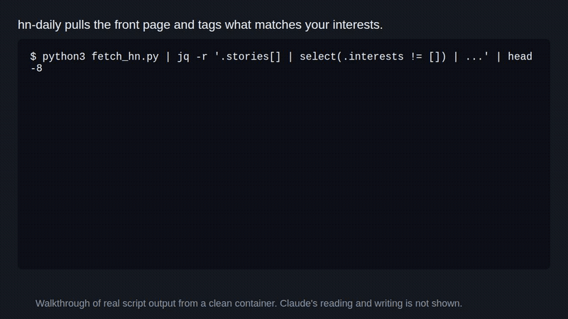

# jod-skills



Four Claude Code skills: audit a codebase, digest Hacker News and GitHub trending, track open PRs.

```bash
claude plugin marketplace add jayhemnani9910/jod-skills && claude plugin install jod-skills@jod-skills
```

[](https://github.com/jayhemnani9910/jod-skills/actions/workflows/ci.yml)

The GIF shows what the scripts behind three of the skills print, run in a clean
container. Claude's part, reading that output and writing the digest or the
audit report, is not in it.

## Usage

Restart Claude Code after installing, then run a skill by name:

```
/audit .
/hn-daily
/github-daily
/oss-status
```

| Skill | What it does |
|---|---|
| [`audit`](plugins/audit) | Finds bugs in a codebase without reading every line. Builds a call graph, runs free checkers, reads only the risky functions, verifies every finding, then asks you what to fix. |
| [`hn-daily`](plugins/hn-daily) | Your morning Hacker News digest. Picks what is worth your time, reads the comments, writes it in plain English. |
| [`github-daily`](plugins/github-daily) | Today's GitHub trending repos, each explained in one plain sentence from its README. Can also deep dive into any one repo. |
| [`oss-status`](plugins/oss-status) | What is waiting on you across your open GitHub work. Reads inline review threads, so a question buried in code review is not missed. |

The install line above gets all four. From inside Claude Code it is:

```
/plugin marketplace add jayhemnani9910/jod-skills
/plugin install jod-skills@jod-skills
```

To pick one instead of all four:

```
/plugin install audit@jod-skills
/plugin install hn-daily@jod-skills
/plugin install github-daily@jod-skills
/plugin install oss-status@jod-skills
```

To update later: `/plugin update jod-skills`.

## How it works

Each skill is a `SKILL.md` that tells Claude what to do, plus small scripts that
do the fetching and counting so Claude does not have to.

- `hn-daily` and `github-daily` call free public endpoints (the Algolia and
  Firebase Hacker News APIs, the GitHub trending page and API). No API key.
  They keep a small history file so the next run can mark what is new.
- `oss-status` runs `gh` and `jq` to collect your open PRs, issues and review
  requests, including inline review comments. Bots are not counted as reviewers.
- `audit` builds a function-level graph with graphify, runs whichever checkers
  you have installed, ranks modules by risk, and gives Claude only the risky
  function bodies to read. Nothing is edited until you pick which findings to fix.

## What each skill needs

| Skill | Needs |
|---|---|
| `hn-daily` | Python 3. No API key. |
| `github-daily` | Python 3. No API key. `GITHUB_TOKEN` only raises the rate limit. |
| `oss-status` | [`gh`](https://cli.github.com) (logged in) and [`jq`](https://jqlang.github.io/jq/). |
| `audit` | Python 3 and [graphify](https://github.com/Graphify-Labs/graphify): `uv tool install graphifyy`. Any checker you already have (ruff, pyright, eslint, tsc, go vet, clippy, semgrep, gitleaks) gets used, missing ones are skipped and reported. Browser testing is optional: `cd <skill folder> && npm i && npx playwright install chromium`. |

## Settings

Nothing is required. Every default is safe. Set these if you want something
else. [.env.example](.env.example) lists them all.

| Env var | Default | Skill |
|---|---|---|
| `HN_DAILY_OUT` | `~/claude-digests/news` | hn-daily |
| `HN_DAILY_STATE` | `~/.local/state/jod-skills/hn-daily/seen.json` | hn-daily |
| `HN_DAILY_INTERESTS` | built-in AI / Startup / Dev lists | hn-daily |
| `GH_DAILY_OUT` | `~/claude-digests/github` | github-daily |
| `GH_DAILY_STATE` | `~/.local/state/jod-skills/github-daily/seen.json` | github-daily |
| `OSS_ACCOUNT` | whoever `gh` is logged in as | oss-status |
| `OSS_STALE_DAYS` | `14` | oss-status |
| `OSS_STATE` | `~/.local/state/jod-skills/oss-status/state.json` | oss-status |
| `TZ` | the machine's timezone | hn-daily, github-daily |

History files live outside the plugin folder on purpose. A plugin update
replaces that folder, and your history should survive it.

## Install without plugins

If you would rather drop the skills straight into `~/.claude/skills/`:

```bash
git clone https://github.com/jayhemnani9910/jod-skills.git
cp -r jod-skills/plugins/*/skills/* ~/.claude/skills/
```

Skip the `jod-skills` bundle folder, it is only a copy of the other four.

## Working on these

The per-skill plugins under `plugins/<name>/` are the source of truth. The
`jod-skills` bundle is generated by `./scripts/sync-bundle.sh`. Setup, tests and
PR rules are in [CONTRIBUTING.md](CONTRIBUTING.md).

## License

MIT. See [LICENSE](LICENSE).
